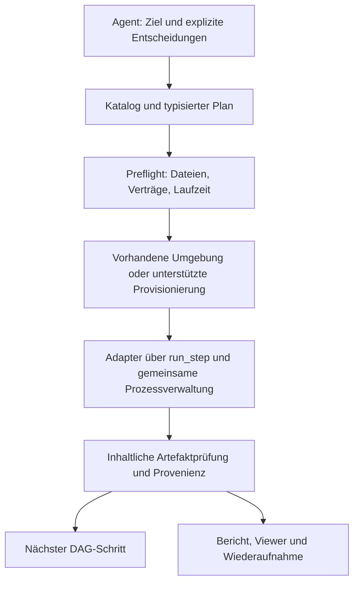

# Biomolekulares Fundament: Architektur, Betrieb und QM-Parität

Stand: 20. November 2026, Draft PR #746. Dieses Verzeichnis beschreibt das
Fundament für agentengesteuerte Docking-, MedChem-, Strukturmodellierungs- und
Simulationsworkflows. Der QM-Teil von DELFIN ist der Maßstab für Betriebsqualität.
Die vollständige Parität ist noch nicht erreicht.

Die Beschreibung gehört bewusst zur Fachkomponente; das Haupt-README ist nicht
der Ort für diese Arbeits- und Abnahmespezifikation.

## Dokumente und maßgebliche Implementierung

- [Review-Stand](REVIEW.md): abgegrenzter PR-Umfang, behobene Blocker und noch
  erforderliche Abnahme vor einem Merge.
- [Installation und Laufzeit](INSTALLATION.md): vorhandene Rezepte, Cluster-Erkennung,
  Provisionierung, Reparatur und Grenzen.
- [Werkzeuge und Visualisierung](TOOLS_AND_VISUALIZATION.md): ausführbare Teilbereiche,
  Katalogeinträge und notwendige Ergänzungen.
- [Abnahme und offene Fundamentarbeit](ACCEPTANCE.md): Kriterien, Testebenen und
  noch ausstehende Integrationen.
- [Workflow-Referenz](../BIOMOLECULAR_WORKFLOWS.md): Ports, Parameter, Beispiele,
  Artefakte, Einschränkungen und Ausführung.
- [QM-Paritätsmatrix](../BIOMOLECULAR_QM_PARITY.md): gemeinsamer Fortschrittsüberblick.

Quellen im Repository sind insbesondere
[`workflows.py`](../../delfin/tools/bio/workflows.py),
[`execution.py`](../../delfin/tools/bio/execution.py),
[`environments.py`](../../delfin/tools/bio/environments.py),
[`artifacts.py`](../../delfin/tools/bio/artifacts.py),
[`simulation.py`](../../delfin/tools/bio/simulation.py) und
[`dynamics.py`](../../delfin/tools/bio/dynamics.py).

## Was QM-Parität hier bedeutet

Ein Tool braucht einen vollständigen Weg von der Erkennung bis zum überprüfbaren
Ergebnis. Ein Name im Katalog, ein gefundener Programmpfad oder ein erzeugtes
Eingabedokument genügt dafür nicht. Für jeden unterstützten Ausführungspfad sind
folgende Teile erforderlich:

1. Vertrag mit typisierten Eingaben und Ausgaben, eindeutigen Einheiten und
   expliziten wissenschaftlichen Entscheidungen.
2. Erkennung einer passenden vorhandenen Installation, einschließlich
   Cluster-Modulen und separaten Python-Umgebungen.
3. Ein dokumentierter Installationsweg: geprüftes isoliertes Rezept oder ein
   klarer externer Bereitstellungsvertrag für nicht automatisch installierbare Tools.
4. Versionierter Adapter mit Ressourcen, Timeout, Prozessverfolgung und
   nachvollziehbaren Fehlern.
5. Inhaltliche Ergebnisprüfung, Identitätserhalt und Provenienz.
6. Komponierbarkeit im Agenten-DAG, Wiederaufnahme und geeignete Darstellung.
7. Schnittstellentests sowie später ein echter Referenzlauf auf dem Zielsystem.

Breite Abdeckung bedeutet ausdrücklich nicht, dass alle wissenschaftlichen
Methoden austauschbar sind. Ladungsmodell, Protonierungszustand, Kraftfeld,
Wassermodell, Docking-Score und experimenteller Endpunkt behalten ihre Bedeutung.

## Aufbau und Datenfluss

`bio_backends` und `bio_plan` dienen der Planung und installieren nichts.
Der dateibasierte Preflight kann begrenzte Versionsprüfungen ausführen.
Erst die Ausführung darf nach gültiger Eingabeprüfung unterstützte fehlende
Abhängigkeiten bereitstellen. Ein nicht implementierter Backend bleibt eine
explizite Ausführungssperre.

Der Executor führt den DAG momentan seriell aus. Er stoppt bei einem Fehler und
protokolliert Ergebnisse und Dateien. Die Wiederaufnahme prüft Eingaben,
Einstellungen, relevante Implementierung, Laufzeitidentität und Artefakt-Hashes.
Ein Workflow-Verzeichnis hat genau einen Schreiber. Das ist kein vollständiger
Snapshot aller Treiber und transitiven Systembibliotheken.

## Wissenschaftliche Identität und Artefakte

Liganden benötigen einen maßgeblichen Molekülgraphen, Ladung, Stereochemie und
Atomzuordnung. PDB-Koordinaten ersetzen diesen Graphen nicht. Bei der
Komplexassemblierung bleibt der ausgewählte Ligand deshalb zusätzlich als SDF
erhalten. Selektion und Assemblierung verschieben die Koordinaten nicht still.

Strukturen behalten Modell, Kette, Residuum, Insertionscode und Atomidentität.
Änderungen durch Vorbereitung müssen vom jeweiligen eingeschränkten Adapter
getragen und geprüft werden. Allgemeine Metall-, Cofaktor- und kovalente
Ligandenchemie ist noch kein unterstützter automatischer Pfad.

OpenMM-Systeme enthalten Struktur, Topologie, Positionen in Nanometern,
serialisiertes System und verwendete Kraftfeld-Dateien mit Hashes. Der Validator
prüft unter anderem Atomreihenfolge, Koordinaten, Massen, Gesamtladung und
Constraints. Periodische Systeme enthalten zusätzlich die Ausgangsstruktur,
Solvent-Kraftfeld und explizite Box-/Ionen-/PME-Einstellungen. Die Prüfung erfasst
Quellatomerhalt, H₂O-Zusammensetzung, Ionenladungen und Ionenzahlen.

Trajektorien und Checkpoints binden Systemidentität, Frame-Abdeckung, Zeit und
Einheiten an das Integratorprotokoll. Periodische Frames und Checkpoints müssen
zur festen Box passen. Ein binärer Checkpoint wird erst beim echten Engine-Laden
auf Hardwarekompatibilität geprüft; es gibt keinen stillen Ersatz durch einen
anderen Neustartmodus.

## Ressourcen und Betrieb

Der gesamte Bio-DAG kann über den bestehenden `delfin-step --slurm`-Pfad laufen.
Strukturierte Parameter werden über `--params-file` übergeben. CPU-Anzahl,
Gesamtspeicher, Laufzeit sowie GPU-/Partitionsanforderung sind explizit. Die
GPU-Anforderung macht einen CPU-only-Adapter nicht GPU-fähig: OpenMM unterstützt
hier bisher nur CPU und Reference. Pro-Knoten-Scheduling und parallele Batches
bleiben offen.

In dieser Entwicklungsumgebung werden weder Pakete/Modelle installiert noch
wissenschaftliche Engines oder echte Cluster-Jobs gestartet. Mock-Tests belegen
Verträge und Fehlerbehandlung; die externe Abnahme muss die echte Laufzeit und
wissenschaftlich geeignete Referenzfälle prüfen.
