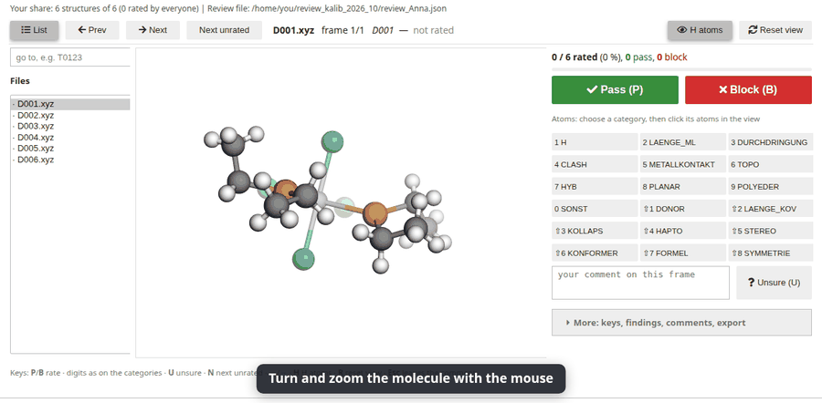

# Rating structures as a team: a guide for reviewers

Thank you for helping. You will look at computer-built 3D structures of
molecules (mostly metal complexes) one at a time and say for each whether a
chemist could accept it (**Pass**) or whether something is wrong
(**Block**), and if so what and where. Your judgement is used to measure how
well an automatic checker sees defects, and to find what the structure
builder should fix next.

Anyone can help, without asking first: **just pick your name**. Several
people share the work: each of you gets a block of 500 structures of your own,
plus 50 that *everyone* rates (so we can measure how much reviewers agree).
You do not need to know which ones those are. Each rating is saved the moment
you give it, and you can stop and continue at any time.

A video walk-through is in [review_team_guide.webm](review_team_guide.webm).



## 1. Get the set (once)

You need a clone of DELFIN and the dashboard installed (see the
[README](../README.md#-quick-start)). Then unpack the structures of the set
into a folder of your own:

```bash
cd DELFIN                                    # your clone
git pull                                     # the newest assignment
delfin review unpack review_sets/kalib_2026_10 ~/review_kalib_2026_10 --name <your name>
```

`~/review_kalib_2026_10` now holds one `.xyz` file per structure, the
category list (`kategorien.txt`) and the shares given out so far
(`assignment.json`). If your name is listed there, that is your share.
Otherwise a block of 500 structures is drawn for you and kept in your own
`review_<your name>.json`. The draw looks at everything already sent back
(`ratings/kalib_2026_10/` in your clone, hence the `git pull`): structures
nobody has rated or reserved come first. About 15 % of every block are
structures that one or two other reviewers also get, spread over the whole
set, so that everybody's ratings can be compared with many others'. Only
when every structure has been rated once do blocks consist of second
ratings. Pick a name nobody else in the project uses, and keep it: best your
GitHub name (left empty, the Review tab takes the account `gh` is logged in
with). Running
`unpack` again never touches your ratings or your block. (Without `--name`
the block is drawn the first time you open the folder in the Review tab.)

**Reserve your block** (recommended, takes a minute): until your ratings
come back, nobody else knows which structures you have. So tell them: press
**Reserve my block** in the Review tab (under the comment field), or in a
terminal:

```bash
delfin review claim ~/review_kalib_2026_10 --name <your name>
```

This opens a small pull request that adds only
`ratings/kalib_2026_10/claims/<your name>.json` (your block, the date and the
set version). Once it is merged, blocks drawn by others leave your
structures out. A reservation runs out after 28 days from its date; the
structures you have not rated by then are given out again. Run `claim`
again to renew it (same block, new date).

## 2. Open your share in the Review tab

1. Start the dashboard: `delfin-voila` (it prints a link with an access
   token; open it in the browser) and go to the tab **Review**.
2. Under **Open a review**: put the folder (`~/review_kalib_2026_10`) into
   **Open**, and your **Name** (always the same name when you come back).
3. **Categories** fills itself from `kategorien.txt` when the folder is
   opened: 18 entries, `H` first and `SYMMETRIE` last. Leave **Blinded**
   unticked.
4. Press **Open**. The status line says *Your share: N structures*; the
   counter on the right, *x / N rated*, the file list and **Next unrated**
   cover only your share.

## 3. Rate a structure

Turn and zoom the molecule in the viewer (mouse), then:

* **P** (or the green button) = **Pass**: the molecule could look like this
  in reality; you would accept it as a starting geometry for a calculation
  or as a figure.
* **B** (or the red button) = **Block**: at least one defect a chemist would
  not accept.

For **Block**, first choose the categories (several are allowed, see the
table below; each button shows a short name, the mouse pointer over it shows
what it means, and **What the categories mean** under the buttons lists them
all), and mark where each defect is:

1. Press the key of a category (or click it). It is now *active* (dark
   frame).
2. Click the one or two atoms where this defect sits. They get a ring in the
   colour of the category; click again to remove.
3. Choose the next category and click its atoms, and so on. The key of a
   category already chosen but not active makes it active again; the key of
   the active category removes it (with its atoms). The x button removes all
   marks.
4. Press **B**.

**Mark every visible defect, not only the worst one.** Otherwise we cannot
measure, category by category, what the checker finds and what it misses.

A different isomer or conformer than you would expect is **not** a defect,
as long as the structure itself is chemically sound.

### Keys

| Key | Does |
|---|---|
| **P** / **B** | Pass / Block (saves and moves to the next unrated structure) |
| **1**-**9**, **0**, **Shift+1** ... **Shift+8** | toggle the categories, in the order of the table |
| **U** | unsure: writes `unsicher` into the comment |
| **N** | next unrated structure |
| **Left** / **Right** | previous / next structure |
| **H** | hide / show the hydrogen atoms |
| **R** | reset the view |
| **Esc** | leave the comment field (the keys work again) |

The field above the file list jumps to a structure (`T0123` or `123`, then
Enter). The list marks each structure with a tick (pass), a cross (block) or
a dot (open).

### Not sure?

Press **U** (it writes `unsicher` into the comment) and still decide **P** or
**B** as well as you can. A free comment is always welcome, and for the
category **Other (comment)** it is required: say what you saw, new categories
come from those comments.

## 4. The 18 categories

| Key | Button | Code (stored) | Meaning |
|---|---|---|---|
| 1 | H atoms | `H` | a hydrogen is missing, stretched, at a wrong angle, points into the metal or sits on the metal |
| 2 | M–L length | `LAENGE_ML` | a metal-ligand or metal-metal distance visibly too long or too short (the ligand is still bound) |
| 3 | Interpenetration | `DURCHDRINGUNG` | interpenetration: ligands or rings stuck through each other, a bond threaded through a ring |
| 4 | Clash | `CLASH` | atoms too close without interpenetration (also H...H) |
| 5 | Metal contact | `METALLKONTAKT` | a heavy atom that is not a donor sits at the metal (a hydrogen at the metal: `H`) |
| 6 | Topology | `TOPO` | topology: a bond missing or one too many, a ligand clearly torn off, a wrong donor atom, a fragment or counter-ion floating away or stuck inside another |
| 7 | Angle / hybrid. | `HYB` | hybridisation / angle: a wrong angle, sp3 flat, sp2 pyramidal, a linear group bent (also one angle at a donor) |
| 8 | Planarity | `PLANAR` | an aromatic ring or sp2 framework not flat, an amide, ester or conjugated bond twisted |
| 9 | Polyhedron | `POLYEDER` | the coordination geometry at the metal is implausible |
| 0 | Other (comment) | `SONST` | something else: **always write a comment** |
| Shift+1 | Donor direction | `DONOR` | a whole donor turned away from the metal, its lone pair not pointing at the metal, the metal out of the donor plane |
| Shift+2 | Bond length | `LAENGE_KOV` | a covalent bond too long or too short |
| Shift+3 | Collapse | `KOLLAPS` | collapse: a ring or ligand balled up, the molecule too compact |
| Shift+4 | Hapticity | `HAPTO` | a pi ligand slipped, wrong hapticity |
| Shift+5 | Stereo | `STEREO` | wrong configuration (R/S, E/Z, atropisomer) |
| Shift+6 | Conformer | `KONFORMER` | an unrealistic conformation (eclipsed, a ring bent, a boat without reason) |
| Shift+7 | Formula | `FORMEL` | formula: atoms missing or too many, an H on the wrong atom (tautomer, protonation) |
| Shift+8 | Symmetry | `SYMMETRIE` | chemically equal parts visibly built unequal (equal ligands at different distances, a Cp ring tilted) |

Where two categories are close:

* stuck through each other = Interpenetration; only too close = Clash;
* one angle at a donor = Angle / hybrid.; the whole donor turned away = Donor direction;
* still bound but too long = M–L length; clearly gone = Topology;
* a hydrogen at the metal = H atoms; a heavy atom at the metal = Metal contact.

## 5. Saving, stopping, continuing

Every rating is saved at once into `review_<your name>.json` in your folder
(the line *saved ...* under the comment shows it). Stop whenever you like:
open the same folder with the same name again and the tab continues at the
first structure you have not rated yet. You do not have to finish your
share; every finished part is useful.

## 6. Send your ratings back

Press **Send my ratings** in the Review tab (under the comment field; it
shows the link to your pull request), or from your clone, in a terminal:

```bash
delfin review submit ~/review_kalib_2026_10 --name <your name>
delfin review submit ~/review_kalib_2026_10 --name <your name> --credit "Ada Lovelace"   # to be listed
```

With `--credit`, the name you give is stored in your file (field `credit`)
and listed among the contributors of the set (`delfin review status`);
`--credit ""` removes it again. Without it nothing is listed.

This copies your `review_<your name>.json` to
`ratings/kalib_2026_10/review_<your name>.json` in a commit of its own on a
new branch and opens a pull request with the GitHub command line `gh` (into
your fork of DELFIN when you cannot push to the project; `gh auth login`
once beforehand). The pull request adds only your own file, so reviewers
never overwrite each other. You can submit again later; the new file
replaces your earlier one.

**Your name belongs to your GitHub account.** The first pull request under
a name (a `submit` or a `claim`) also adds
`ratings/kalib_2026_10/owners/<your name>.json` with the GitHub account it
comes from (the one `gh` is logged in with, or `--github <login>`). A
maintainer looks at that first pull request and merges it; from then on
pull requests under this name are accepted only from that account, and
they can be merged automatically.

Without `gh` or GitHub access: the command says what is left to do (give
`--github <your login>` so that the owner file is added), or simply send
the file `review_<your name>.json` to the coordinator.

## For the coordinator

```bash
delfin review status review_sets/kalib_2026_10                         # how far the set is
delfin review merge  review_sets/kalib_2026_10                         # CSVs, agreement, reliability
delfin review merge  review_sets/kalib_2026_10 --split calibration     # only the calibration part
delfin review assign review_sets/kalib_2026_10 Anna Ben                # reserve blocks (optional), then commit
```

For a folder `review_sets/<set>` of the clone, all of them read
`ratings/<set>/` (review files and `claims/`) by themselves; `--ratings`
adds further folders.

**Who gets what.** Nobody has to be added before helping: a name not in
`assignment.json` draws its own block (`self_block`, 500) into its review
file, so helpers' pull requests never touch a common file. Every draw (a
helper's, and `assign` for named reviewers) counts what it can see: every
rating sent back, every block drawn into a review file and every claim not
older than 28 days. Structures with nobody first; a share of each block
(`redundancy` in `assignment.json`, default 0.15) goes to the structures
meant for two or three reviewers: that share of the set, drawn once with
the seed and spread over the whole set (two thirds of it for two reviewers,
one third for three), preferring those that already have a reviewer, so
every reviewer overlaps with many others (an incomplete block design). The
50 structures everyone rates stay as they are. Second ratings of the rest
are drawn only when everything has one. The draw depends only on the seed,
the name and the ratings and claims it sees, so it can be reproduced; a
self-drawn block records what it saw (`drawn_from`). The shared structures
(`--overlap`) and the test part are fixed when the assignment is first
drawn; `--redundancy` can be changed later and applies to blocks drawn from
then on.

**`status`** prints how many structures are rated 0, 1, 2 or 3+ times, the
progress of the calibration and the test part, the reservations (named,
self-drawn and claimed; active or expired), the reviewers, Krippendorff's
alpha for ok/defect with its interval, the self-consistency on structures
shown twice (below), and the contributors who asked to be listed
(`credit`).

**`merge`** writes three CSVs and prints the statistics, all on the part
given by `--split` (default `all`):

* `review_merged_<set>.csv` -- every rating of every reviewer (columns
  `rater`, `shared`, `share` = shared / own / extra, `split`).
* Cohen's kappa (two reviewers) or Fleiss' kappa (more) and the share of
  frames on which all agree, for ok/defect and every category.
* Krippendorff's alpha (nominal; any number of reviewers per structure,
  missing ratings allowed) for ok/defect and every category, with a 95 %
  bootstrap interval over the structures (`--bootstrap`, default 1000
  draws, seeded).
* The Dawid-Skene model, fitted by EM, for ok/defect and every category:
  the sensitivity and specificity of every reviewer (printed for ok/defect,
  all in `review_merged_<set>_raters.csv`) and, per structure, the
  probability of a defect and of every category, which weighs reliable
  reviewers more than a majority vote does
  (`review_merged_<set>_consensus.csv`, column `consensus` = block when the
  probability is 0.5 or more).
* Self-consistency: how often a reviewer gives the same verdict to the same
  structure shown twice. The pairs are found from the geometry of the set
  (the same atoms, the same coordinates after a proper rotation; a mirror
  image does not count); only counts are printed. `--repeats <file>` gives
  them from a private list instead (JSON `{file: group}` or pairs).
* Controls: which structures are experimental crystal structures is never
  part of a public set, so nothing public reports on them. `--controls
  <private key>` (JSON `{file: true}` or a CSV with `id`/`file` and `source`
  or `control`) prints, for those structures only, how many each reviewer
  passed and the mean consensus probability of a defect. Keep that output
  out of the repository.

Ratings of the **test** part are a pre-registered hold-out: never use them
to tune anything. With `--split calibration` nothing of the test part enters
any number or file: the model is fitted without it and the consensus CSV
holds no test structure.

**Checking helpers' pull requests.** `.github/workflows/ratings.yml` runs on
every pull request that touches `ratings/**` and calls
`delfin/review_check.py` from the base commit (so a pull request cannot
change its own rules). A helper's pull request (it changes a
`review_<name>.json` or a `claims/<name>.json`, the first time with
`owners/<name>.json`) passes when it changes exactly that, the file is
valid (set and set version, structures of the set, categories of
`kategorien.txt`, atoms within the structure, the name inside equal to the
file name, a claim of at most one block dated today or earlier), a file
already on `main` keeps its token, and the account rule holds: a name whose
owner file is on `main` is used only by that GitHub account (the author of
the pull request), a new name is bound by its first pull request to the
author's account, and an owner file on `main` never changes. Other pull
requests are left to the ordinary review.

**Automatic merging** (prepared): a valid pull request from the account a
name is bound to gets `gh pr merge --auto --squash`; the first pull request
of a new name gets the comment "first contribution, maintainer review" and
is merged by a maintainer, which binds the name. The workflow runs on
`pull_request_target` so that this works for pull requests from forks: it
checks out only the base commit, reads the pull request as git objects
without checking it out, and only the two small jobs that merge or comment
have write permissions (they check out nothing). It takes effect only with
two repository settings: Settings > General > **Allow auto-merge**, and a
ruleset (or branch protection) on `main` that requires status checks,
including **ratings pull request**. Without them nothing merges by itself.

**Identical structures and the split.** Structures that are geometrically
the same (shown twice on purpose, or built alike) are kept in one part of
the test split: `new-set` and `assign` find them (the same search as the
self-consistency) and join them with `--groups`. For a set drawn before
this, `assign <set> --regroup-split` moves every group that straddles the
split wholly into the part that holds most of it, records the change with
date, reason and counts in `split.changes`, and leaves the shared structures
and the named blocks as they are; do it only before any rating, and note it
in the set's README.

## Adding a review set

A set lives in `review_sets/<set>/`, its ratings in `ratings/<set>/`:

```
review_sets/<set>/
  structures.xyz.gz   all structures, one XYZ frame each, the comment line only the id
  kategorien.txt      the defect categories, one per line, in the order of the keys
  assignment.json     the shares, the test part and the parameters of the draw
  README.md           what the set is, where the structures come from, their licences
ratings/<set>/
  review_<name>.json  one file per reviewer (delfin review submit)
  claims/<name>.json  one file per reservation (delfin review claim)
  owners/<name>.json  the GitHub account a name belongs to (added by its first pull request)
```

Make the public part with `new-set` from a multi-frame XYZ file in which
every frame is one structure:

```bash
delfin review new-set all.xyz review_sets/<set> --categories kategorien.txt --renumber
```

It writes the archive (reproducibly, the same input gives the same bytes),
the categories, `assignment.json` with the test part drawn now, and a
`README.md` with TODOs to fill in. Without `--renumber` the comment lines
must be plain, unique ids. Options: `--seed`, `--test-fraction` (default
0.2), `--overlap` (default 50), `--self-block` (default 500), `--redundancy`
(default 0.15), `--groups` (JSON `{id: group}`: a group, e.g. a structure
shown twice, stays in one part of the split; geometrically identical
structures are kept together anyway). Blinding (rotating, sorting
atoms, hiding the source) is not done by `new-set`; it is done before, on
the private side.

`assignment.json` holds: `version` (of the format), `seed`, `files_total`,
`shared` (the files everyone rates), `raters` (blocks of named reviewers),
`split` (`seed`, `test_fraction`, `grouped`, `identical_kept_together`, `test`:
the test files, `changes`: dated corrections made before any rating),
`self_block`, `redundancy`, `set`, `set_version` (a hash of the frames;
every review and claim names it), `created` and `updated`.

Two rules are not negotiable:

* **No data of the Cambridge Structural Database (CSD)** in a set, its
  README or its ratings: no coordinates, no refcodes, nothing derived from
  them. Experimental structures come from open sources such as the
  Crystallography Open Database (CC0); name the source and the licence in
  the README.
* **The test part is fixed before anything is rated** (`new-set` draws it at
  once) and never changes afterwards. Its ratings only measure; they never
  tune.
